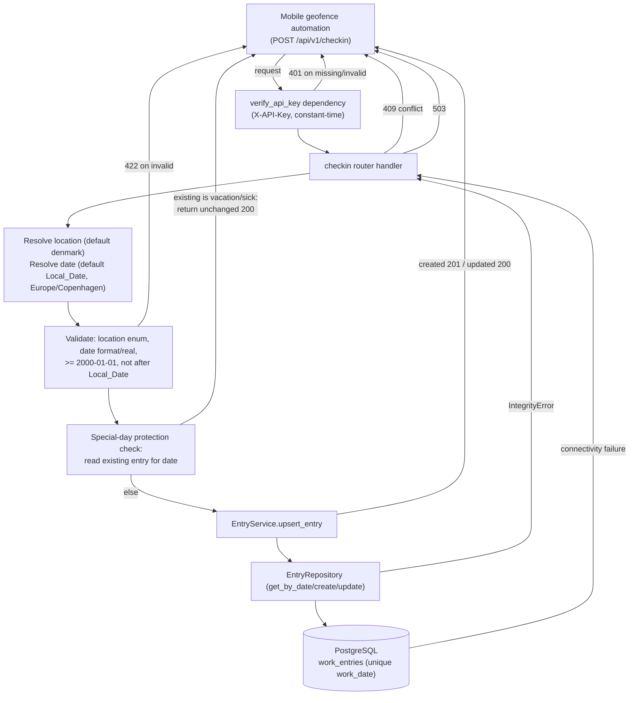

# Design Document

## Overview

The Geofence Check-In API adds a single authenticated `POST` endpoint to the existing Work Location Tracker backend that lets a mobile geofence automation (iOS Shortcuts, Tasker, etc.) log a work-location entry with no request body. It defaults the location to `denmark` and the date to "today" in the `Europe/Copenhagen` timezone, upserts exactly one `WorkEntry` per calendar day, and protects manually-logged `vacation`/`sick` days from being overwritten by an automated trigger.

The design deliberately **reuses** the existing building blocks rather than duplicating them:

| Concern | Reused component | Location |
|---|---|---|
| Create/update one row per date | `EntryService.upsert_entry` | `backend/services/entry_service.py` |
| Allowed location values | `WorkLocation` enum | `backend/schemas.py` |
| Persistence + one-row-per-date guarantee | `WorkEntry` (unique constraint on `work_date`) | `backend/models.py` |
| Response shape | `WorkEntryResponse` | `backend/schemas.py` |
| Authentication | `verify_api_key` dependency | `backend/auth.py` |
| Session + connectivity → 503 translation | `get_session` proxy | `backend/database.py` |
| 503 exception handlers | `create_app` | `backend/main.py` |

The **only genuinely new behavior** is:

1. **Query-driven defaulting** — resolve `location` (default `denmark`) and `date` (default Local_Date) from optional query parameters with no body required.
2. **Local_Date resolution** — compute "today" in `Europe/Copenhagen` (DST-aware).
3. **Special-day protection** — an automated check-in must never overwrite an existing `vacation`/`sick` entry, but may overwrite `home`/`denmark`.

Everything else (401, 409, 422 validation, 503) is handled by machinery that already exists in the codebase; the design shows how to wire the new endpoint into it.

### Research notes

- **Timezone handling**: Python 3.12 ships the standard-library `zoneinfo` module. `datetime.datetime.now(ZoneInfo("Europe/Copenhagen")).date()` yields the DST-aware local calendar date. `zoneinfo` resolves offsets from the IANA tz database; on Linux (Clever Cloud / dev) the system tzdata is present, and the `tzdata` PyPI package is the portable fallback. This matches the Clever Cloud + uv steering (add `tzdata` via `uv add tzdata` if the base image lacks system zoneinfo data). Reference: [Python `zoneinfo` docs](https://docs.python.org/3/library/zoneinfo.html).
- **Existing future-date validation**: `WorkEntryCreate.date_not_in_future` already rejects `v > date.today()`. The check-in endpoint needs a timezone-aware notion of "today" (Local_Date) plus a `2000-01-01` lower bound, so date validation is performed in the router/validation layer against Local_Date rather than relying solely on the existing naive `date.today()` validator.
- **409 conflict**: The entries `POST` handler already catches `IntegrityError`, rolls back, and raises `409`. The check-in endpoint mirrors this pattern exactly.
- **503 availability**: `get_session` wraps DB operations and raises `DatabaseUnavailableError`; `create_app` registers handlers mapping `DatabaseUnavailableError` / `OperationalError` / `InterfaceError` to `503 {"detail": "Database unavailable"}`. The check-in endpoint inherits this automatically by depending on `get_session`. The 5-second connection timeout (Requirement 8.1) is configured on the async engine via `connect_args`/`pool_timeout`.

## Architecture

The endpoint follows the existing layered architecture: Router → Service → Repository → Database. No layer is bypassed; all writes flow through `EntryService.upsert_entry`.



### Request flow (happy path)

1. `verify_api_key` validates `X-API-Key` (401 on missing/invalid/empty).
2. Resolve `location`: use supplied query value when a non-empty exact enum match; otherwise `denmark`.
3. Resolve `date`: use supplied `YYYY-MM-DD` query value; otherwise Local_Date (now in `Europe/Copenhagen`).
4. Validate resolved date: real calendar date, `>= 2000-01-01`, not strictly after Local_Date (else 422).
5. Read the existing entry for the date. If it is a Special_Day (`vacation`/`sick`), return it unchanged with `200`.
6. Otherwise call `EntryService.upsert_entry(date, location)`. New row → `201`; updated/unchanged existing working-location row → `200`.
7. Serialize via `WorkEntryResponse`.

## Components and Interfaces

### New: `backend/routers/checkin.py`

A new router mounted under `/api/v1/` exposing one endpoint. It reuses `EntryService`, `EntryRepository`, `get_session`, and `WorkEntryResponse`.

```python
# backend/routers/checkin.py (interface sketch, not final implementation)

router = APIRouter(prefix="/api/v1", tags=["checkin"])


@router.post("/checkin", response_model=WorkEntryResponse)
async def checkin(
    response: Response,
    db: Annotated[AsyncSession, Depends(get_session)],
    location: Annotated[str | None, Query()] = None,
    date_param: Annotated[str | None, Query(alias="date")] = None,
) -> WorkEntryResponse: ...
```

Responsibilities:

- Resolve and validate `location`/`date` (see Validation component).
- Enforce special-day protection by reading the existing entry before writing.
- Set the HTTP status code dynamically (`201` created, `200` updated/unchanged) via the `Response` object, because a single path can return either.
- Translate `IntegrityError` → `409` (mirroring `entries.create_entry`).
- Depend on `get_session` so connectivity failures become `503` automatically.

The router is registered in `create_app` exactly like the others, guarded by the shared-secret dependency:

```python
app.include_router(checkin.router, dependencies=[Depends(verify_api_key)])
```

### New: request resolution & validation helpers

A small, pure, testable helper module (e.g. `backend/services/checkin_resolver.py` or functions within the router module) encapsulating the new logic so it can be property-tested without HTTP or a database:

- `local_date(now: datetime | None = None) -> date` — returns the current calendar date in `Europe/Copenhagen`. Accepts an injectable `now` (an aware UTC instant) for deterministic testing.
- `resolve_location(raw: str | None) -> WorkLocation` — returns the `WorkLocation` for a non-empty exact match; `denmark` when `None`/empty; raises a validation error otherwise.
- `resolve_date(raw: str | None, today: date) -> date` — parses `YYYY-MM-DD` strictly; defaults to `today`; raises a validation error for malformed text, non-real dates, dates `< 2000-01-01`, or dates `> today`.
- `is_special_day(location: WorkLocation) -> bool` — `location in {VACATION, SICK}`.

Validation errors surface as HTTP `422` with a machine-readable `detail` that distinguishes the failure cause (future date, invalid format, invalid calendar date, out-of-range, invalid location). Using `HTTPException(status_code=422, detail=...)` keeps the 422 contract distinct from the 401/409/503 error bodies.

### Reused components (unchanged)

- `backend.auth.verify_api_key` — attached at router inclusion; produces `401 {"detail": "Invalid or missing API key"}`.
- `backend.services.entry_service.EntryService.upsert_entry` — the sole write path (Requirement 7.1).
- `backend.repository.EntryRepository.get_by_date` — used read-only for special-day protection and to distinguish create (`201`) vs update (`200`).
- `backend.schemas.WorkEntryResponse` — response model; `WorkLocation` — allowed values.
- `backend.database.get_session` + `create_app` 503 handlers — availability handling.

### Engine connection timeout (Requirement 8.1)

The async engine is configured with a 5-second connection acquisition/connect timeout so an unreachable database fails fast into the existing `DatabaseUnavailableError` → `503` path rather than hanging:

```python
create_async_engine(
    url,
    pool_pre_ping=True,
    pool_timeout=5,  # wait at most 5s for a pooled connection
    connect_args={"timeout": 5},  # asyncpg connect timeout (seconds)
)
```

## Data Models

No schema change. The feature persists through the existing `WorkEntry` model and reuses the existing Pydantic schemas.

### Existing `WorkEntry` (persistence)

| Column | Type | Notes |
|---|---|---|
| `id` | int PK | autoincrement |
| `work_date` | date | **unique** (one row per calendar day) |
| `location` | enum(`home`,`denmark`,`vacation`,`sick`) | |
| `created_at` | datetime(tz) | server default `now()` |
| `updated_at` | datetime(tz) | server default `now()`, `onupdate now()` |

### Request parameters (new)

| Parameter | Source | Type | Default | Validation |
|---|---|---|---|---|
| `location` | query | string | `denmark` | exact enum match or empty→default; else 422 |
| `date` | query | string | Local_Date | `YYYY-MM-DD`, real date, `>= 2000-01-01`, `<= Local_Date`; else 422 |
| `X-API-Key` | header | string | — | constant-time equal to Shared_Secret; else 401 |
| body | body | — | ignored | no body required (Requirement 1.7) |

### Response model (reused `WorkEntryResponse`)

Exactly these fields, serialized as `application/json`:

| Field | Type | Representation |
|---|---|---|
| `id` | int | positive integer |
| `work_date` | date | ISO `YYYY-MM-DD` |
| `location` | enum string | one of `home`/`denmark`/`vacation`/`sick` |
| `created_at` | datetime | ISO 8601 date-time |
| `updated_at` | datetime | ISO 8601 date-time |

### Resolved request (internal value object)

A `ResolvedCheckIn(work_date: date, location: WorkLocation)` produced by the resolver/validation layer and passed to the write path. This is the pure, property-testable core of the feature.

## Correctness Properties

*A property is a characteristic or behavior that should hold true across all valid executions of a system — essentially, a formal statement about what the system should do. Properties serve as the bridge between human-readable specifications and machine-verifiable correctness guarantees.*

PBT (property-based testing) is appropriate here because the new logic is largely pure and has clear input/output behavior: timezone date resolution, location/date parsing and validation, and the upsert + special-day-protection decision over a known starting state. These exhibit universal properties (defaulting, round-trips of valid inputs, invariants, idempotence, error conditions) across a large input space (all dates, all enum values, all malformed strings, all clock instants), so running 100+ generated examples finds edge cases that a handful of unit tests would miss. Infrastructure concerns (auth wiring, concurrent 409 conflict, 5-second timeout, 503 availability, transactional atomicity) are **not** property-tested — they are covered by integration/example tests as noted in the Testing Strategy.

### Reflection (redundancy elimination)

The prework identified several overlapping criteria that were consolidated:

- Defaulting criteria (1.2, 1.5, 1.6) collapse into one resolver-defaulting check plus the "bare request writes denmark on Local_Date" write check.
- Timezone criteria (2.1, 2.2, 2.3) collapse into a single zone-conversion check; DST-transition and midnight-boundary instants become edge cases in the generator.
- Special-day protection criteria (4.2, 4.4) merge: 4.4 is 4.2 generalized over all incoming locations, so the generator ranges the incoming location across all four `WorkLocation` values.
- Response-contract criteria (6.1, 6.2, 6.3, 6.4, 6.5) merge into one response-contract check asserting the exact field set, types, and per-branch status code; the "equal to stored entry" aspect of 6.3 is validated by the special-day check.

The remaining properties each provide unique validation value.

### Property 1: Location resolution and defaulting

*For any* location query input, `resolve_location` returns the exactly-matching `WorkLocation` when the input is a non-empty exact enum string, and returns the Default_Location `denmark` when the input is `None` or the empty string.

**Validates: Requirements 1.3, 1.5**

### Property 2: Valid date resolution and defaulting

*For any* date query input, `resolve_date(input, today)` returns the parsed date when the input is a valid `YYYY-MM-DD` string within `[2000-01-01, today]`, and returns `today` when the input is `None` or the empty string.

**Validates: Requirements 1.4, 1.6**

### Property 3: Local_Date is the Europe/Copenhagen calendar date

*For any* timezone-aware instant (including instants near the spring-forward and fall-back DST transitions and near local midnight), `local_date(now)` resolves to exactly one calendar date equal to that instant converted to the `Europe/Copenhagen` timezone (`now.astimezone(ZoneInfo("Europe/Copenhagen")).date()`).

**Validates: Requirements 2.1, 2.2, 2.3**

### Property 4: Bare check-in creates a Local_Date denmark entry

*For any* starting database state with no entry for the Local_Date, a check-in with no `location` and no `date` creates exactly one Work_Entry whose `work_date` equals the Local_Date and whose `location` equals `denmark`.

**Validates: Requirements 1.2**

### Property 5: Check-in on an empty date creates the resolved entry

*For any* resolved request `(date, location)` where no Work_Entry exists for `date`, the check-in creates exactly one Work_Entry for `date` whose `location` equals the resolved `location`.

**Validates: Requirements 4.1**

### Property 6: Special-day protection preserves the stored entry

*For any* target date whose existing Work_Entry is a Special_Day (`vacation` or `sick`), and *for any* resolved request `location` (ranging over all four `WorkLocation` values), the check-in leaves that entry's `location`, `work_date`, and `created_at` unchanged, creates no additional Work_Entry, and leaves exactly one row for that date.

**Validates: Requirements 4.2, 4.4**

### Property 7: Working-location entries are overwritten

*For any* target date whose existing Work_Entry has a Working_Location (`home` or `denmark`), and *for any* resolved request `location`, the check-in sets that entry's `location` to the resolved `location` and leaves exactly one row for that date.

**Validates: Requirements 4.3**

### Property 8: Check-in idempotence

*For any* resolved request `(date, location)` and *for any* starting database state, applying the check-in twice in succession (with no intervening change) produces the same persisted Work_Entry (`work_date` and `location`) as applying it once, and leaves exactly one row for that date.

**Validates: Requirements 4.5**

### Property 9: At-most-one entry per calendar date

*For any* sequence of resolved check-in requests applied to an initially empty database, after processing there is at most one Work_Entry per `work_date`.

**Validates: Requirements 7.2**

### Property 10: Future dates are rejected

*For any* resolved date strictly later than the Local_Date, date validation rejects the request with a future-date error (HTTP 422) and no Work_Entry is created or modified. A resolved date equal to the Local_Date is accepted.

**Validates: Requirements 5.1, 5.2**

### Property 11: Malformed and non-real dates are rejected

*For any* date query string that either does not match the `YYYY-MM-DD` pattern or matches the pattern but does not denote a real calendar date, `resolve_date` rejects it with an invalid-date error (HTTP 422) and no Work_Entry is created or modified.

**Validates: Requirements 5.3, 5.4**

### Property 12: Dates before 2000-01-01 are rejected

*For any* real date strictly earlier than `2000-01-01`, date validation rejects the request with an out-of-range error (HTTP 422) and no Work_Entry is created or modified.

**Validates: Requirements 5.5**

### Property 13: Invalid location values are rejected

*For any* non-empty location query string that is not an exact match of a `WorkLocation` value, `resolve_location` rejects it with an invalid-location error (HTTP 422) and no Work_Entry is created or modified.

**Validates: Requirements 5.6**

### Property 14: Response contract

*For any* successful check-in (create, update, or unchanged special-day), the JSON response body contains exactly the fields `id`, `work_date`, `location`, `created_at`, `updated_at` and no others, with `id` a positive integer, `work_date` an ISO `YYYY-MM-DD` string, `location` one of the `WorkLocation` string values, and `created_at`/`updated_at` ISO 8601 date-time strings; the status code is `201` when a new entry is created and `200` when an existing entry is updated or left unchanged.

**Validates: Requirements 6.1, 6.2, 6.3, 6.4, 6.5**

## Error Handling

The endpoint reuses the codebase's established error-handling patterns. Each error class produces a distinct status code and a machine-readable JSON body so the mobile client can tell them apart (Requirements 3, 5, 7.3, 8.3).

| Condition | Status | Body (`detail`) | Mechanism |
|---|---|---|---|
| Missing / invalid / empty `X-API-Key` | 401 | `"Invalid or missing API key"` | `verify_api_key` → `AuthError` (reused) |
| Invalid `location` value | 422 | location-not-allowed message | `HTTPException(422)` from `resolve_location` |
| Malformed `date` text | 422 | invalid-format message | `HTTPException(422)` from `resolve_date` |
| Pattern-valid but non-real `date` | 422 | invalid-calendar-date message | `HTTPException(422)` from `resolve_date` |
| Resolved `date` in the future | 422 | future-date message | `HTTPException(422)` from date validation |
| Resolved `date` before 2000-01-01 | 422 | out-of-range message | `HTTPException(422)` from date validation |
| Unique-constraint violation (concurrent insert) | 409 | `"Entry already exists for this date"` | catch `IntegrityError`, `rollback`, raise 409 (mirrors `entries.create_entry`) |
| Database unreachable (incl. 5s connect timeout) | 503 | `"Database unavailable"` | `get_session` → `DatabaseUnavailableError`; `create_app` handlers (reused) |

Key guarantees:

- **No write on rejection**: 401 is enforced before the handler runs; 422 is enforced before any write call; 409 rolls back before responding; 503 surfaces from the DB boundary with the transaction never committed. Thus 401/422/409/503 never create or modify a Work_Entry (Requirements 3.2–3.4, 5.1/5.3/5.4/5.5, 7.3, 8.2, 8.4).
- **Distinct 503**: The 503 body (`{"detail": "Database unavailable"}`) is distinct from the 401/409/422 bodies, letting the client distinguish an outage from a client error (Requirement 8.3).
- **Atomicity**: Writes go through a single `commit` in the repository; a connectivity failure during the write leaves the transaction uncommitted, so no partial entry persists (Requirement 8.4).
- **Fail-fast timeout**: `pool_timeout=5` and asyncpg `connect_args={"timeout": 5}` ensure an unreachable database produces a 503 within ~5 seconds rather than hanging (Requirement 8.1).

## Testing Strategy

A dual approach: property-based tests for the universal logic properties above, and example/integration/smoke tests for infrastructure and wiring that do not vary meaningfully with input.

### Tooling

- **Test runner**: `pytest` (`uv run pytest`), `asyncio_mode = "auto"` (already configured).
- **Property-based library**: `hypothesis` (already a dev dependency). Do not hand-roll property testing.
- **HTTP integration**: `httpx.AsyncClient` over `ASGITransport` against an app from `create_app()`, with `get_settings` overridden to the test shared secret and `get_session` overridden to in-memory SQLite (mirrors `conftest.py`, `test_entries_router.py`, `test_db_errors.py`).
- **Timezone data**: ensure `Europe/Copenhagen` is resolvable in CI; add the `tzdata` package via `uv add tzdata` if the runner lacks system zoneinfo.
- Lint/format with `uv run ruff check .` and `uv run ruff format .`.

### Property tests (minimum 100 iterations each)

Each correctness property maps to **exactly one** property-based test configured with `@settings(max_examples=100, deadline=None)` and tagged with a comment:

`# Feature: geofence-checkin-api, Property {number}: {property_text}`

Isolation follows the existing pattern in `test_entry_repository_properties.py`: each generated example builds its own fresh in-memory SQLite database so examples are independent. Pure-logic properties (1, 2, 3, 10–13) test the resolver/validation helpers directly without a database. Write-path properties (4–9, 14) drive the service/repository (or the endpoint via `AsyncClient`) against a fresh DB per example.

Generators:

- `WorkLocation` values via `st.sampled_from(list(WorkLocation))`.
- Valid in-range dates via `st.dates(min_value=date(2000,1,1), max_value=today)`.
- Future dates via `st.dates(min_value=today + 1 day, ...)`; pre-2000 via `st.dates(max_value=date(1999,12,31))`.
- Malformed/non-real date strings via `st.text()` filtered to non-ISO, plus explicit edge generators for `YYYY-MM-DD` patterns with impossible month/day (e.g. `2025-02-30`, `2025-13-01`).
- Aware instants via `st.datetimes(timezones=st.just(timezone.utc))` including a biased set near DST transitions (late March, late October) and local midnight.

| Property | Test focus | Layer |
|---|---|---|
| 1 | location resolution/defaulting | pure helper |
| 2 | valid date resolution/defaulting | pure helper |
| 3 | Local_Date zone conversion (DST/midnight edges) | pure helper |
| 4 | bare check-in → Local_Date/denmark | service + DB |
| 5 | create on empty date | service + DB |
| 6 | special-day preservation (all incoming locations) | service + DB |
| 7 | working-location overwrite | service + DB |
| 8 | idempotence | service + DB |
| 9 | at-most-one-per-date invariant over sequences | service + DB |
| 10 | future-date rejection (today boundary edge) | validation |
| 11 | malformed/non-real date rejection | validation |
| 12 | pre-2000 rejection | validation |
| 13 | invalid-location rejection | validation |
| 14 | response contract (fields/types/status) | endpoint via AsyncClient |

### Example / edge-case tests

- **1.1, 1.7**: endpoint exists and accepts POST; request with no body and request with an arbitrary JSON body both succeed identically.
- **3.1–3.4**: valid key reaches handler; missing/wrong/empty `X-API-Key` → 401 with no DB change (3.4 empty key is an explicit edge case).
- **5.2**: `date == Local_Date` accepted (boundary edge, also covered within Property 10's generator).
- **5.4**: explicit impossible-but-pattern-valid dates (`2025-02-30`, `2025-13-01`).
- **7.1**: unit test with a spy/mock asserting the handler writes **only** through `EntryService.upsert_entry` and issues no other write.

### Integration / smoke tests

- **7.3**: force `IntegrityError` on a write and assert `409`, no duplicate row, existing entry unchanged (mirrors the entries-router conflict handling).
- **8.1–8.4**: simulate a connectivity failure at the session boundary (as in `test_db_errors.py`) and assert `503` with body `{"detail": "Database unavailable"}`, non-2xx status, and no persisted/partial change. A config/smoke test asserts the engine is constructed with the 5-second `pool_timeout` / connect timeout.

### Unit-test balance

Property tests cover the broad input space (defaulting, resolution, protection, idempotence, invariants, validation, response contract). Unit/example tests are kept lean and focused on concrete wiring, boundary values, and error branches that property tests do not exercise, avoiding redundant example tests where a property already provides coverage.
