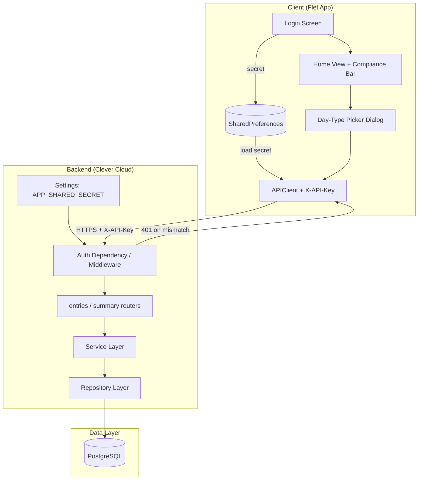
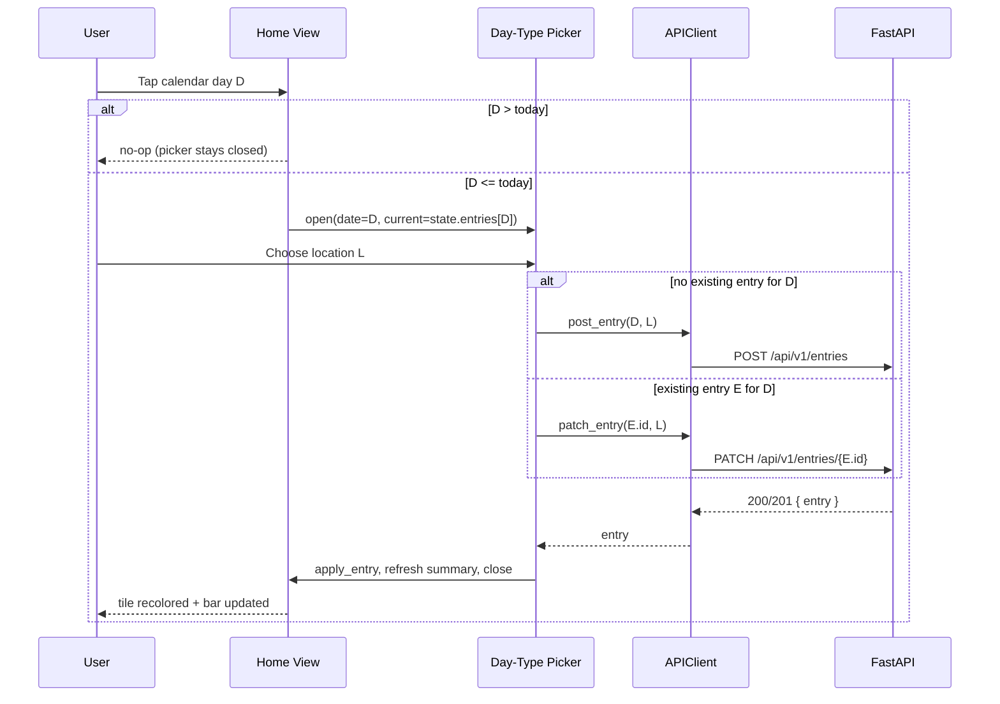
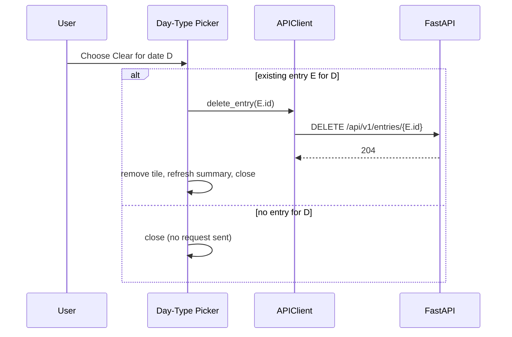
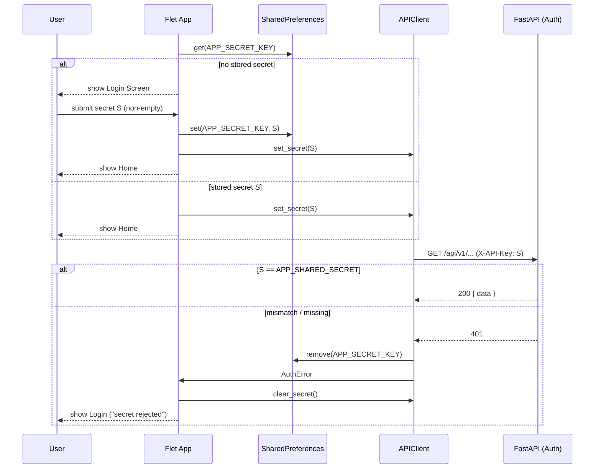

# Design Document: Work Day Enhancements

## Overview

This document designs three enhancements to the existing Work Location Tracker (a Flet frontend + FastAPI backend that lets a Swedish resident working in Denmark log daily work locations and track the 50% Denmark-presence rule):

1. **Day-type picker** — tapping any past-or-today calendar day opens an `ft.AlertDialog` offering the four existing `WorkLocation` choices plus a Clear action, wired to the existing POST / PATCH / DELETE entry endpoints. Future dates are rejected before the dialog ever opens.
2. **Front-page compliance score** — the home view renders the existing `compliance_bar` component driven by the already-loaded current-month `ComplianceSummary` (green when compliant, red when not, neutral when absent).
3. **Shared-secret access** — a Flet login screen gates the app; the `APIClient` attaches an `X-API-Key` header to every request; the backend verifies that header against the `APP_SHARED_SECRET` environment variable on every request and aborts startup if the variable is missing; a `401` clears the stored secret and returns the user to the login screen.

The design reuses the patterns established in the `work-location-tracker` spec: runtime-free pure helpers for all business logic (testable without the Flet runtime), thin Flet wrappers around them, an application-factory FastAPI backend, `pydantic-settings` for config, and `hypothesis` property-based tests alongside `pytest` example tests. Only the shared-secret feature introduces new backend code; features 1 and 2 are almost entirely frontend changes against unchanged endpoints.

The four location types (`home`, `denmark`, `vacation`, `sick`) already exist end-to-end. No authentication exists today — the shared-secret feature is net new.

---

## Architecture



The three features touch distinct layers:

| Feature | Frontend changes | Backend changes |
|---|---|---|
| 1. Day-type picker | `components/day_type_picker.py` (new), `views/home_view.py` (wire tap) | none (reuses POST/PATCH/DELETE) |
| 2. Front-page compliance | `views/home_view.py` (already renders `compliance_bar`) | none |
| 3. Shared-secret access | `views/login_view.py` (new), `api_client.py`, `state.py`, `main.py` | `config.py`, `auth.py` (new), `main.py`, `.env.example` |

---

## Sequence Diagrams

### Open the Day-Type Picker and assign a location



### Clear a day



### Shared-secret auth lifecycle



---

## Components and Interfaces

### Feature 1 — Day-Type Picker

#### New: `app/components/day_type_picker.py`

A pure builder plus runtime-free apply/clear coroutines, mirroring the existing edit/delete flow in `home_view.py`.

```python
# Pure eligibility gate (Requirements 1.1, 1.5).
def can_open_picker(day: date, today: date | None = None) -> bool:
    """Return True iff day is on or before today."""
    return day <= (today or date.today())


# Human-readable labels for the four choices, reusing the existing colours.
PICKER_LABELS: dict[WorkLocation, str] = {
    WorkLocation.DENMARK: "Office / Denmark",
    WorkLocation.HOME: "Work from Home",
    WorkLocation.VACATION: "Vacation",
    WorkLocation.SICK: "Sick Day",
}


def build_day_type_picker(
    work_date: date,
    current: WorkEntry | None,
    on_select: Callable[[WorkLocation], None],
    on_clear: Callable[[], None],
    on_dismiss: Callable[[], None],
) -> ft.AlertDialog:
    """Build the picker dialog with four location choices + Clear.

    When ``current`` is not None the option matching ``current.location`` is
    marked as the currently recorded choice (Requirement 1.3).
    """
    ...
```

The picker reuses the colour map and labels already defined in `home_view.py`/`entry_tile.py` so the dialog reads in the same visual language as the calendar grid and quick-log buttons.

#### New runtime-free coroutine: `apply_day_type(state, api_client, work_date, location, *, generation=None) -> bool`

This is the "upsert from the picker" logic. It decides POST vs PATCH from existing state, matching the backend's own upsert semantics and the existing `APIClient.post_entry` (which already falls back to PATCH on `409`):

```python
async def apply_day_type(
    state: AppState,
    api_client: APIClient,
    work_date: date,
    location: WorkLocation,
    *,
    generation: int | None = None,
) -> bool:
    existing = state.entries.get(work_date.isoformat())
    guard = _backend_guard(state, generation)
    try:
        if existing is None:
            entry = await api_client.post_entry(work_date.isoformat(), location)  # POST
        else:
            entry = await api_client.patch_entry(existing.id, location)  # PATCH
    except APIError as exc:
        if guard.is_stale(state):
            return False
        _record_error(state, classify_error(exc))  # tile unchanged (Req 2.6)
        return False
    if guard.is_stale(state):
        return False
    state.apply_entry(entry)
    state.clear_error()
    await _refresh_summary(state, api_client, generation=generation)  # Req 2.4
    return True
```

#### New runtime-free coroutine: `clear_day_type(...)`

Reuses the existing `delete_entry` logic but adds the "no entry → no DELETE" short-circuit required by Requirement 3.4:

```python
async def clear_day_type(state, api_client, work_date, *, generation=None) -> bool:
    existing = state.entries.get(work_date.isoformat())
    if existing is None:
        return True  # close, send no DELETE, state unchanged (Req 3.4)
    return await delete_entry(state, api_client, existing, generation=generation)
```

#### Changed: `app/views/home_view.py`

The calendar grid already exposes a per-day callback (`on_day_long_press`). The day-type picker is wired to a **tap** callback. `calendar_grid.build_calendar_grid` gains an `on_day_tap: Callable[[int], None] | None` parameter alongside the existing long-press hook; each day tile sets `tile.on_click` to a handler bound to its day number. The home view's tap handler:

1. Resolves the tapped day to a `date` in `state.selected_month`.
2. Calls `can_open_picker(day)`; if `False`, returns immediately (Requirement 1.5).
3. Opens `build_day_type_picker(...)` via `page.show_dialog(...)`, passing `state.entries.get(iso)` as `current`.
4. On select → `page.run_task(apply_day_type(...))`, then `_refresh()` and `page.pop_dialog()`; on error, `_surface_error` reuses the existing classification surfaces.
5. On clear → `page.run_task(clear_day_type(...))`, then refresh + close.
6. On dismiss → `page.pop_dialog()` only (Requirement 1.4).

The existing long-press edit/delete menu continues to work; the picker is additive.

### Feature 2 — Front-Page Compliance Bar

No new component is needed. `app/components/compliance_bar.py` already:

- renders `value = clamp(compliance_pct / 100.0)` (Requirement 4.1),
- colours `GREEN_600` when `is_compliant` else `RED_700` (Requirements 4.2, 4.3),
- renders a neutral bar with `value=0` and no tooltip when `summary is None` (Requirement 4.4).

`home_view.build_home_view` already places `build_compliance_bar(state.compliance_summary)` at the top of the column and `_refresh()` already rebuilds it from the latest summary after every mutation (Requirement 4.5). The only change required is a one-line alignment of the neutral colour: Requirement 4.4 specifies `ft.Colors.SURFACE`, while the current component uses `ft.Colors.SURFACE_CONTAINER_HIGHEST`. The design adopts `ft.Colors.SURFACE` for the `None` case to match the requirement exactly.

Because the current-month summary is already loaded at startup (`_load_initial_data` → `load_month`) and after every entry change, Feature 2 is effectively "already wired" and this spec only verifies and tightens it.

### Feature 3 — Shared-Secret Access

#### Backend: `app/`-side vs `backend/`-side separation

**New: `backend/auth.py`** — a FastAPI dependency that verifies the header. A dependency (applied to both routers) is preferred over raw middleware because it integrates with FastAPI's dependency-injection and OpenAPI, and it only guards the API routes (leaving CORS pre-flight `OPTIONS` and any mounted Flet frontend unaffected). It reads the expected value from `Settings`, not the environment directly, keeping configuration in one place.

```python
API_KEY_HEADER = "X-API-Key"


class AuthError(HTTPException):
    def __init__(self) -> None:
        super().__init__(status_code=401, detail="Invalid or missing API key")


def verify_api_key(
    x_api_key: Annotated[str | None, Header(alias=API_KEY_HEADER)] = None,
    settings: Settings = Depends(get_settings),
) -> None:
    """Allow the request iff the header equals APP_SHARED_SECRET (Req 7.2, 7.3)."""
    expected = settings.app_shared_secret
    if x_api_key is None or not secrets.compare_digest(x_api_key, expected):
        raise AuthError()
```

`secrets.compare_digest` is used for a constant-time comparison to avoid timing side-channels on the secret.

The dependency is attached at router-inclusion time so **every** entries and summary route is guarded uniformly:

```python
# backend/main.py (create_app)
app.include_router(entries.router, dependencies=[Depends(verify_api_key)])
app.include_router(summary.router, dependencies=[Depends(verify_api_key)])
```

**Changed: `backend/config.py`** — add the required setting and a `get_settings` provider:

```python
class Settings(BaseSettings):
    app_shared_secret: str | None = None  # from APP_SHARED_SECRET
    # ... existing database fields ...

    @property
    def required_shared_secret(self) -> str:
        value = (self.app_shared_secret or "").strip()
        if not value:
            raise SharedSecretConfigurationError(
                "APP_SHARED_SECRET is not set. Set it to the shared secret the "
                "Flet app sends in the X-API-Key header."
            )
        return value
```

**Changed: `backend/main.py` lifespan** — Requirement 7.4 (abort startup when the variable is absent). The existing `_lifespan` already validates `DATABASE_URL` when `validate_config` is on; add a parallel check that reads `settings.required_shared_secret`, which raises `SharedSecretConfigurationError` (logged clearly) and aborts startup if missing. Tests keep `validate_config=False`, so they are unaffected and inject a known secret via a `get_settings` dependency override.

**Changed: `.env.example`** — add an `APP_SHARED_SECRET=` entry documenting the variable (Requirement 7.5).

#### Frontend: `app/`

**Changed: `app/api_client.py`** — the client gains a mutable secret and attaches it as a header on every request:

```python
class APIClient:
    def __init__(self, base_url: str, secret: str | None = None) -> None:
        self._base_url = base_url.rstrip("/")
        self._secret = secret or None

    def set_secret(self, secret: str | None) -> None:
        self._secret = secret or None

    @property
    def has_secret(self) -> bool:
        return bool(self._secret)

    def _headers(self) -> dict[str, str]:
        return {"X-API-Key": self._secret} if self._secret else {}
```

`_request` merges `self._headers()` into every outgoing call (Requirement 6.1). A new `AuthError(APIError)` subclass is raised when the backend returns `401`; `_request` detects `401` before the generic status handling and raises `AuthError` so callers can distinguish "secret rejected" from other failures (Requirement 8.1). The `401` branch is checked on every method, so it is universal across the client surface.

**Changed: `app/state.py`** — add the current screen and auth fields:

```python
class Screen(Enum):
    LOGIN = auto()
    HOME = auto()


@dataclass
class AppState:
    ...
    screen: Screen = Screen.LOGIN
    auth_rejected: bool = False  # drives the "secret rejected" login message
```

**New: `app/views/login_view.py`** — a pure validator plus a thin view builder:

```python
APP_SECRET_KEY = "APP_SHARED_SECRET"  # SharedPreferences key


def validate_secret(value: str) -> str | None:
    """Return an error message when the secret is empty/blank, else None."""
    return None if value.strip() else "Please enter the shared secret."


async def load_secret(storage: KeyValueStorage) -> str | None:
    stored = await storage.get(APP_SECRET_KEY)
    value = str(stored).strip() if stored is not None else ""
    return value or None


async def save_secret(storage: KeyValueStorage, value: str) -> str:
    secret = value.strip()
    await storage.set(APP_SECRET_KEY, secret)
    return secret


async def clear_secret(storage: KeyValueStorage) -> None:
    await storage.remove(APP_SECRET_KEY)


def resolve_initial_screen(stored_secret: str | None) -> Screen:
    """LOGIN when no usable stored secret, else HOME (Req 5.1, 5.2)."""
    return Screen.HOME if (stored_secret or "").strip() else Screen.LOGIN
```

The `KeyValueStorage` protocol is extended with `remove(key)` (used on `401` and already available on Flet's `SharedPreferences`).

**Changed: `app/main.py`** — the bootstrap resolves the initial screen from the stored secret before the first paint:

- On startup, `await load_secret(storage)`; if present, `api_client.set_secret(secret)` and render `HOME`; otherwise render `LOGIN` and **do not** call `_load_initial_data` (Requirements 5.1, 6.2).
- The login submit handler validates the secret, persists it, calls `api_client.set_secret`, loads initial data, and navigates to `HOME` (Requirement 5.3). Empty input stays on `LOGIN` with a validation message (Requirement 5.4).
- A central `handle_auth_error()` is invoked whenever any `page.run_task` coroutine raises `AuthError`: it calls `await clear_secret(storage)`, `api_client.set_secret(None)`, sets `state.auth_rejected = True`, `state.screen = Screen.LOGIN`, and repaints (Requirements 8.1, 8.2, 8.3). The login view shows the "secret rejected" message when `state.auth_rejected` is set.

---

## Data Models

No database schema changes. The `work_entry` table, `WorkLocation` enum, and all request/response schemas from the `work-location-tracker` spec are reused unchanged. The day-type picker and clear flows operate entirely through the existing `WorkEntryCreate` (POST), `WorkEntryUpdate` (PATCH), and DELETE contracts.

New in-memory/config state:

| Field | Location | Type | Purpose |
|---|---|---|---|
| `AppState.screen` | `app/state.py` | `Screen` enum | Current gated screen (LOGIN/HOME) |
| `AppState.auth_rejected` | `app/state.py` | `bool` | Drives the "secret rejected" message |
| `APIClient._secret` | `app/api_client.py` | `str \| None` | Secret attached as `X-API-Key` |
| `Settings.app_shared_secret` | `backend/config.py` | `str \| None` | Expected secret from `APP_SHARED_SECRET` |

---

## Error Handling

Reuses the existing frontend error classification (`classify_error` → inline / banner / snackbar+refresh / notification) for all entry operations, so the day-type picker's error surfaces (Requirements 2.6, 3.5) match the rest of the app. New additions:

| Condition | Backend | Frontend recovery |
|---|---|---|
| Missing/mismatched `X-API-Key` | `401` from `verify_api_key` dependency (Req 7.3) | `APIClient` raises `AuthError`; `main.handle_auth_error` clears secret + returns to login (Req 8.1–8.3) |
| `APP_SHARED_SECRET` absent at startup | Lifespan raises `SharedSecretConfigurationError`, logs the variable name, aborts startup (Req 7.4) | n/a |
| Empty secret submitted | n/a | Login validation message, stay on login (Req 5.4) |
| Future date tapped | n/a (no request sent) | Picker never opens (Req 1.5) |
| Upsert/clear error | existing `422`/`404`/`409`/`503` contract | existing classification; tile/state preserved (Req 2.6, 3.5) |

The `401` branch takes precedence over the existing `503` back-off and `409` PATCH-retry logic: an authentication failure is never retried.

---

## Correctness Properties

*A property is a characteristic or behavior that should hold true across all valid executions of a system — essentially, a formal statement about what the system should do. Properties serve as the bridge between human-readable specifications and machine-verifiable correctness guarantees.*

After the prework analysis, redundant criteria were consolidated: the upsert-routing criteria (2.1, 2.2, 2.3) are combined into one routing property; the compliance-bar value/colour criteria (4.1, 4.2, 4.3) are combined into one rendering property; and the `401` recovery criteria (8.1, 8.2) are combined into one property. Pure UI-presence, config-sourcing, and startup-abort criteria (1.2, 1.4, 2.5, 3.3, 4.4, 4.5, 6.2, 7.1, 7.4, 7.5, 8.3) are covered by example/smoke tests rather than properties.

### Property 1: Future dates never open the picker

*For any* date strictly after today, `can_open_picker(date)` returns `false`; and *for any* date on or before today, it returns `true`.

**Validates: Requirements 1.1, 1.5**

### Property 2: Picker indicates the recorded location

*For any* `WorkEntry` with any `WorkLocation`, the picker built for that entry marks exactly the option matching the entry's location as the currently recorded choice, and marks no other option as current.

**Validates: Requirements 1.3**

### Property 3: Upsert routing (POST vs PATCH)

*For any* eligible date and chosen `WorkLocation`: when `state.entries` has no entry for that date, `apply_day_type` issues a POST to the entries endpoint; when `state.entries` already has an entry for that date, it issues a PATCH to that entry's id. In both cases, on success exactly one entry for that date exists in `state.entries` and its location equals the chosen location.

**Validates: Requirements 2.1, 2.2, 2.3, 2.4**

### Property 4: Upsert idempotence

*For any* eligible date and chosen `WorkLocation`, applying `apply_day_type` twice in succession with the same inputs leaves `state.entries` with exactly one entry for that date whose location equals the chosen location — identical to applying it once (`apply(apply(s)) == apply(s)`).

**Validates: Requirements 2.1, 2.3, 2.4**

### Property 5: Upsert error preserves the tile

*For any* backend `APIError` raised during `apply_day_type`, `state.entries` is left unchanged and `state.error_message` is populated.

**Validates: Requirements 2.6**

### Property 6: Clear deletes only when an entry exists

*For any* date: when `state.entries` has an entry for that date, `clear_day_type` issues a DELETE for that entry's id and, on success, removes the date from `state.entries`; when `state.entries` has no entry for that date, `clear_day_type` issues no DELETE request and leaves `state.entries` unchanged.

**Validates: Requirements 3.1, 3.2, 3.4**

### Property 7: Clear error keeps the entry visible

*For any* backend `APIError` raised during `clear_day_type` for a date with an existing entry, the entry remains in `state.entries` and `state.error_message` is populated.

**Validates: Requirements 3.5**

### Property 8: Compliance bar reflects the summary

*For any* `ComplianceSummary`, `build_compliance_bar(summary)` produces a bar whose `value` equals `clamp(compliance_pct / 100.0, 0.0, 1.0)` and whose colour is `ft.Colors.GREEN_600` when `is_compliant` is true and `ft.Colors.RED_700` when it is false.

**Validates: Requirements 4.1, 4.2, 4.3**

### Property 9: Initial screen gate

*For any* stored-secret value, `resolve_initial_screen` returns `HOME` when the value is a non-blank string and `LOGIN` when the value is `None`, empty, or whitespace-only.

**Validates: Requirements 5.1, 5.2**

### Property 10: Empty secret is rejected

*For any* string consisting solely of whitespace (including the empty string), `validate_secret` returns a non-null error message; and *for any* string containing at least one non-whitespace character, it returns `null`.

**Validates: Requirements 5.4**

### Property 11: Non-empty secret is persisted and sent

*For any* non-empty secret `S`, after a successful login submit the storage contains the trimmed `S` under the secret key, the `APIClient` reports `has_secret == true`, and the resolved screen is `HOME`.

**Validates: Requirements 5.3**

### Property 12: Every request carries the configured secret

*For any* configured secret `S` and *for any* `APIClient` request method, the outgoing HTTP request includes an `X-API-Key` header whose value equals `S`.

**Validates: Requirements 6.1**

### Property 13: The backend accepts only the exact secret

*For any* configured `APP_SHARED_SECRET` value `S` and *for any* supplied `X-API-Key` header value `H`: the request reaches its route handler when `H == S`, and the request is rejected with HTTP `401` (handler not reached) when `H != S` or the header is absent.

**Validates: Requirements 7.2, 7.3**

### Property 14: A 401 clears the stored and in-memory secret

*For any* `APIClient` request method that receives an HTTP `401` response, the stored secret is removed from local storage, the client's in-memory secret is cleared (`has_secret == false`), and the resolved screen becomes `LOGIN`.

**Validates: Requirements 8.1, 8.2**

---

## Testing Strategy

Follows the `work-location-tracker` conventions: runtime-free pure helpers tested with `pytest` + `hypothesis`; Flet views never start the runtime; the backend uses `create_app()` with dependency overrides and in-memory SQLite.

### Property-Based Testing (`hypothesis`)

- **Library**: `hypothesis`, minimum **100 iterations** per property test.
- Each property test is tagged **Feature: work-day-enhancements, Property N: {property text}** and references its design property.
- Generators: `hypothesis` strategies for dates (around `date.today()` to exercise the picker gate), `WorkLocation` via `st.sampled_from`, secrets via `st.text()` (including whitespace-only cases for Property 10), and header/secret pairs (equal and unequal) for Property 13.
- Backend auth properties (12, 13, 14) use FastAPI's `TestClient`/`httpx.ASGITransport` against an app built with `create_app()` and a `get_settings` override supplying a known secret; the DB session is overridden to in-memory SQLite so auth is tested independently of persistence.
- Client-header property (12) captures outgoing requests with a mocked `httpx.AsyncClient` and asserts the `X-API-Key` header across every public method.

### Example & Edge-Case Tests (`pytest`)

- **1.2** picker builds four location options + Clear.
- **1.4 / 2.5 / 3.3** dismiss/select/clear invoke the correct close behaviour.
- **4.4** `build_compliance_bar(None)` is neutral (`ft.Colors.SURFACE`, `value=0`, no tooltip).
- **4.5** `_refresh()` rebuilds the bar from an updated summary.
- **6.2** a client with no secret stays on login and issues no entry/summary requests.
- **7.1** `Settings` reads `APP_SHARED_SECRET` only from the environment.
- **7.4** building/starting the app with `APP_SHARED_SECRET` unset aborts startup and logs the variable name (smoke).
- **7.5** `.env.example` contains an `APP_SHARED_SECRET` entry (smoke).
- **8.3** returning to login after a `401` shows the "secret rejected" message.

### Integration Tests

- A guarded route (e.g. `GET /api/v1/summary/monthly`) returns `401` with no/wrong header and `200` with the correct header, end-to-end through the dependency and router (1–2 representative examples complementing Property 13).

---

## Deployment: Clever Cloud

One new environment variable must be set before deploying this change, in addition to the existing `DATABASE_URL` / `CC_PYTHON_*` variables:

| Variable | Description |
|---|---|
| `APP_SHARED_SECRET` | The shared secret the Flet app sends in `X-API-Key`; the backend aborts startup if unset (Req 7.4) |

```bash
clever env set APP_SHARED_SECRET -- "<a-long-random-secret>"
```

The secret is never committed; `.env.example` documents the variable with an empty placeholder for local development. No migration is required for this feature set.
